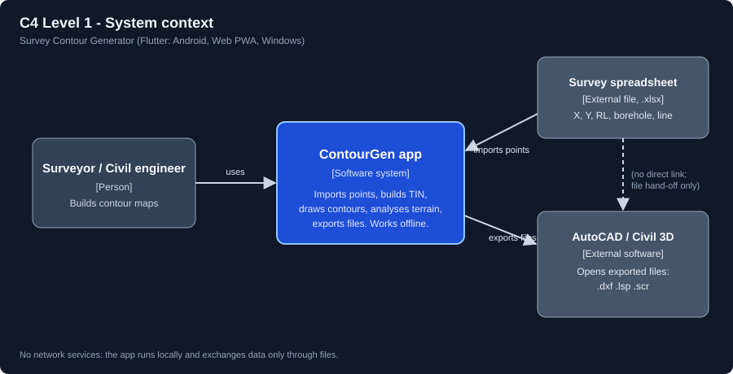
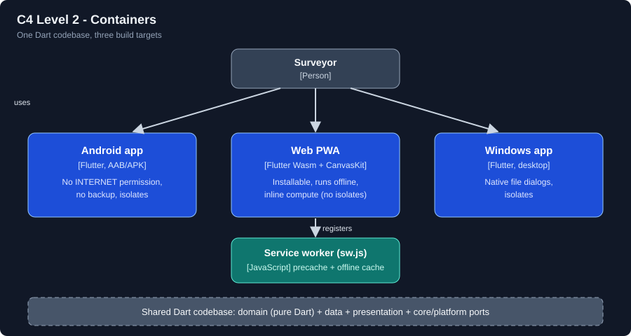
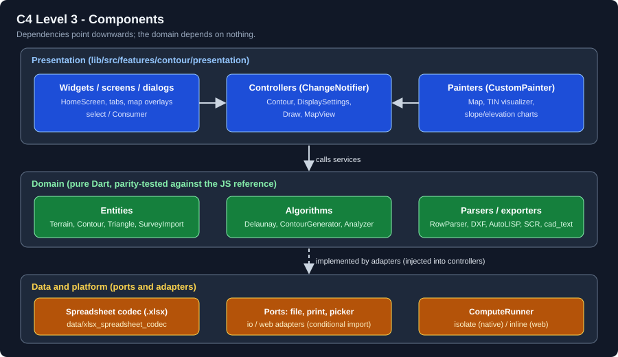
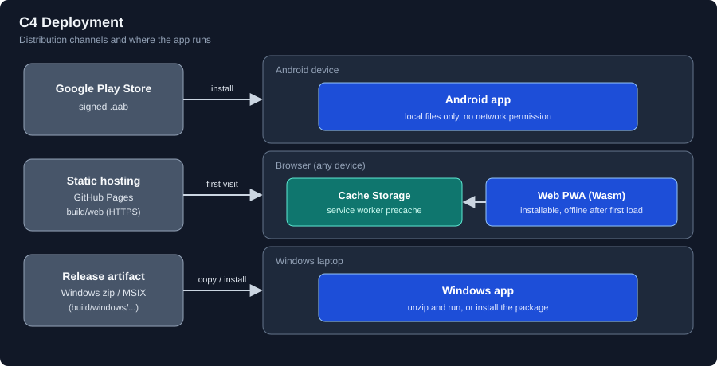

# Survey Contour Generator

A professional survey contour map generator for civil engineers and surveyors, available as an Android app, an installable offline web app and a Windows app. Built on Triangulated Irregular Network (TIN) methodology using Delaunay Triangulation, it produces publication-quality contour maps and exports directly to AutoCAD-compatible formats.

> **This application was generated using AI assistance.**

**Try it now:** [makeshvineeth.github.io/survey-contour-generator](https://makeshvineeth.github.io/survey-contour-generator/) - runs in your browser, installs as an app and then works offline.

---

## Features

- **TIN-based contouring** — Bowyer-Watson Delaunay Triangulation with Catmull-Rom spline smoothing for accurate, smooth contour lines
- **Excel import** — Load survey point data (X, Y, RL/elevation) directly from `.xlsx` files (legacy `.xls` is not supported)
- **Breakline support** — Breakline vertices are added to the TIN so triangle edges follow ridges and valleys. They are not enforced as hard constraints.
- **Interactive canvas** — Pan, zoom, and inspect the contour map with mouse/touch controls
- **TIN visualizer** — Animated step-by-step Delaunay triangulation construction
- **Terrain analysis** — Auto-generated engineering summary with slope distribution, area calculations, and elevation statistics
- **Works offline** — All code and fonts are bundled; no internet is needed after installation
- **Multiple export formats:**

  | Format | Description |
  |--------|-------------|
  | `.dxf` | AutoCAD DXF R12 — contours and survey points |
  | `.lsp` | AutoLISP script for direct AutoCAD import |
  | `.scr` | Civil 3D command script |
  | `.png` | High-resolution raster image (3000×3000 px) |
  | `.bmp` | Bitmap image (3000×3000 px) |
  | `.xlsx` | Processed survey data export |
  | Print | System print dialog |

---

## Platforms

| Platform | Distribution | Offline |
|----------|--------------|---------|
| Android (API 24+) | Signed APK / App Bundle | Yes, the app needs no network permission |
| Web | [Hosted on GitHub Pages](https://makeshvineeth.github.io/survey-contour-generator/), installable PWA (Chrome, Edge and other modern browsers with WebAssembly support) | Yes, after the first online visit |
| Windows 10/11 | Release build (zip) | Yes |

---

## Getting Started

### Android app
1. Install the signed APK (or the Play Store build) on your device.
2. Open **ContourGen**, tap **Import Excel** and pick your `.xlsx` file. No account or internet connection is needed.

### Web app (installable, works offline)
1. Open [makeshvineeth.github.io/survey-contour-generator](https://makeshvineeth.github.io/survey-contour-generator/) once while online. The app downloads itself into the browser cache.
2. Use the browser's **Install** option (install icon in the address bar, or *Add to Home screen* on mobile) to install it as an app.
3. From then on it starts and works without a connection. When a new version is published, it is picked up on the next online visit.

### Windows app
1. Extract the release zip to a folder (or install the package, if provided).
2. Run `survey_contour_generator.exe`. No installer privileges or internet connection are required.

---

## Input Format

Import survey data via an Excel (`.xlsx`) file. The first matching column name in the list is used (names are the column headers):

| Data | Accepted column names |
|------|-----------------------|
| Easting | `X`, `Easting`, `E` |
| Northing | `Y`, `Northing`, `N` |
| Elevation (reduced level) | `RL`, `Z`, `Elevation`, `Elev` |
| Point name | `BoreholeID`, `BH`, `ID`, `Name`, `Point`, `Borehole` |
| Breakline name | `LineName`, `BreakLine`, `Line` |

A value of `0` is valid and is kept. Additional columns are ignored.

---

## Usage

1. Click **Import Excel** and select your survey point file
2. Adjust contour interval as needed
3. Optionally define breaklines via the Breakline editor
4. Click **Generate Contours**
5. Inspect the map, view the terrain summary, then export in your preferred format

---

## Packages Used

Dependencies from `pubspec.yaml` (all bundled into the app, nothing is loaded from a CDN):

| Package | Purpose |
|---------|---------|
| [Flutter](https://flutter.dev) / [material_ui](https://pub.dev/packages/material_ui) | UI framework and Material widgets |
| [provider](https://pub.dev/packages/provider) | State management (`ChangeNotifier`) |
| [excel](https://pub.dev/packages/excel) | `.xlsx` reading and writing |
| [file_picker](https://pub.dev/packages/file_picker) | Open/save file dialogs |
| [printing](https://pub.dev/packages/printing) | Print dialog |
| [pdf](https://pub.dev/packages/pdf) | Print page wrapper |
| [web](https://pub.dev/packages/web) | Browser APIs for the web adapters |
| [flutter_lints](https://pub.dev/packages/flutter_lints) (dev) | Lint rules |

Fonts: Outfit and JetBrains Mono (bundled in `assets/fonts`).

---

## Developer

### Architecture
Feature-first Clean Architecture. The contour algorithms live in a pure-Dart domain layer
(`lib/src/features/contour/domain`, no Flutter or `dart:io`/`dart:html` imports, enforced by a test).
Presentation uses `ChangeNotifier` controllers with `provider`; the map, charts and TIN animation are
drawn with `CustomPainter`. Platform differences (file save/pick, print, compute) sit behind ports in
`lib/src/core/platform` with conditional-import adapters for native and web.

C4 diagrams:






### Commands
```
flutter pub get
flutter analyze
flutter test
flutter build apk --release
flutter build appbundle --release --obfuscate --split-debug-info=build/app/outputs/symbols
flutter build web --release --wasm --no-web-resources-cdn --web-content-hash
flutter build windows --release
tool/deploy_pages.sh        # build the web app and publish it to GitHub Pages (gh-pages branch)
```
Release Android builds are signed from the git-ignored `android/key.properties`; there is no debug-signing fallback.
See [AGENTS.md](AGENTS.md) for the project rules.

### Parity fixtures
`test/fixtures/parity.json` holds expected results produced by the original JavaScript implementation
(`contour-v12_4-tin-fixed.html`, kept in the repo as the reference). Regenerate with Node.js:

```
node tool/gen_parity_fixtures.js contour-v12_4-tin-fixed.html test/fixtures/parity.json
```

`flutter test` compares the Dart domain output with these fixtures.

### Architecture decision records
- [0001 Flutter for Android, Web and Windows](.docs/adr/0001-flutter-for-android-web-windows.md)
- [0002 Feature-first Clean Architecture, pure-Dart domain, parity tests](.docs/adr/0002-feature-first-clean-architecture-pure-dart-domain.md)
- [0003 Provider + ChangeNotifier](.docs/adr/0003-provider-changenotifier-state.md)
- [0004 CustomPainter for map, charts and TIN](.docs/adr/0004-custompainter-for-map-charts-tin.md)
- [0005 Offline web: Wasm, bundled CanvasKit, custom service worker](.docs/adr/0005-offline-web-wasm-custom-service-worker.md)
- [0006 Removal of "Make Offline" and the CDN boot screen](.docs/adr/0006-remove-make-offline-and-cdn-boot-screen.md)
- [0007 Android release hardening](.docs/adr/0007-android-release-hardening.md)
- [0008 Zero-value import fix and CAD label sanitization](.docs/adr/0008-import-zero-values-and-cad-label-sanitization.md)

See also [CHANGELOG.md](CHANGELOG.md).

---

## Version

**v13.0.0** — Flutter port of v12.4 (build date of the original single-file app: 2026-01-26)

---

## License

This project is open source under the [MIT License](LICENSE). It is provided as-is for engineering and surveying use; no warranty is expressed or implied.
